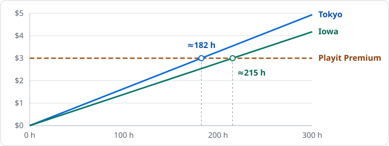

# Minecraft Proxy

Minecraft Proxy is a desktop app that exposes local Minecraft Java servers through temporary Google Compute Engine (GCE) relays. Each hostname has its own relay. Players connect using a domain you manage in Cloudflare. Set up a relay with the [setup guide](docs/setup.md).

The [v1 branch](https://github.com/sya-ri/minecraft-proxy/tree/v1) contains the Docker Compose setup for routing to multiple Minecraft servers through an existing public server.

## Service comparison

✓ Supported · △ With limitations · ✗ Unavailable · ? Unverified. List prices in USD, checked November 27, 2026.

| Service | Price | Stable public endpoint | Your own hostname | Java list ping on your hostname | UDP |
| --- | --- | --- | --- | --- | --- |
| [ngrok Free](https://ngrok.com/pricing) | Free with card verification for TCP | ✗ Random hostname and port | △ A TCP DNS alias needs updating when the endpoint changes | ? | ✗ [TCP only](https://ngrok.com/compare/tailscale) |
| [ngrok Hobbyist](https://ngrok.com/docs/gateway/domains/tcp-addresses) | US$10/month on monthly billing | ✓ One reserved TCP address | △ [CNAME with assigned port](https://ngrok.com/docs/gateway/domains/custom-domains#using-custom-domains-with-tcp-endpoints), or Java SRV | ? | ✗ TCP only |
| [Playit Free](https://playit.gg/) | Free | ✓ Assigned hostname and port for the lifetime of the tunnel | △ Java SRV workaround | △ Worked on the assigned name. Failed with the custom SRV setup tested | ✓ Standalone UDP tunnels |
| [Playit Premium](https://playit.gg/support/playit-premium/) | From US$3/month | ✓ Assigned hostname and port | ✓ [External domain registration](https://playit.gg/support/external-domain-cloudflare/) | ? | ✓ Generic TCP+UDP tunnels |
| Minecraft Proxy | About US$0.0165 per relay hour in Tokyo | ✓ Stable hostname. IP can change between sessions | ✓ Cloudflare DNS, direct TCP 25565 | ✓ Checks the Java status response before publishing DNS | ✓ TCP and optional UDP on one relay |

ngrok's full custom-domain registration starts at US$20/month on Pay-as-you-go. TCP aliases use an assigned TCP address. [ngrok pricing](https://ngrok.com/pricing)

The Playit Free observations are from one tunnel with a Minecraft Java 1.21.11 server. The assigned name returned a server-list ping. The custom SRV name reached the start of login, but its list ping was reset.

### Monthly relay cost

At Playit Premium's US$3 starting price, **Minecraft Proxy is cheaper below about 182 relay hours per month** and **Playit Premium is cheaper above that**. That's roughly six hours of relay uptime a day in a 30-day month. If Playit Free covers the features you need, it costs US$0 at any usage level. [Playit pricing](https://playit.gg/)

The Tokyo estimate uses one `e2-micro` (about US$0.01075/hour), a 10 GiB standard boot disk (about US$0.00071/hour), and an ephemeral public IPv4 address (US$0.005/hour). Count every hour each relay runs, including when nobody is connected. Two relays running for one hour count as two relay hours. The estimate assumes the VM and disk are deleted between sessions and excludes network transfer, taxes, and domain registration. GCE transfer charges can move the break-even point earlier. [GCE compute pricing](https://cloud.google.com/products/compute/pricing/general-purpose) · [Disk pricing](https://cloud.google.com/compute/disks-image-pricing) · [IPv4 and transfer pricing](https://cloud.google.com/vpc/network-pricing#ipaddress)

## Design

[Requirements and design](docs/design.md)
