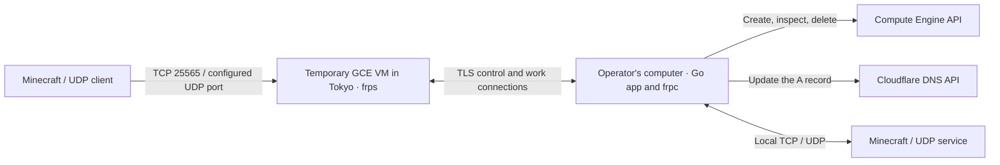

# Minecraft Proxy v2 design

## Requirements

| Audience | Outcome |
| --- | --- |
| Server operator | Start and stop a relay on Windows, macOS, or Linux. See its state, public address, and expiry. |
| Minecraft Java player | Enter the operator's custom hostname and reach the server for both list ping and login. |
| UDP client | Reach the configured UDP service through the same hostname and its UDP port. |
| Server operator | The relay VM and boot disk are deleted when the session expires, even if the operator's computer goes offline. |

One configuration manages one relay. The operator runs Minecraft and stores the world on their own computer.

## Architecture

Use Wails v3 and React / TypeScript for the desktop UI. Go manages OAuth, GCE, Cloudflare DNS, and the `frpc` process. Verify each supported OS. The initial Linux baseline is an environment with GTK4 and WebKitGTK 6.0.

Bundle the official `frpc` executable for the target OS and CPU. At startup, the VM fetches `frps` at the same pinned version and verifies its checksum. Include the frp license in distributions. Authenticate the frp control connection with a session-specific token and verify the server certificate over TLS.

## Setup and UI

The operator configures the GCE project, Tokyo zone, VPC, Cloudflare zone, public hostname, local ports, and session duration. Provision the VPC firewall rule and target tag during setup. Include the public UDP port when the relay will forward UDP.

Google and Cloudflare authorization opens in the system browser. Use desktop OAuth clients with the Authorization Code flow and PKCE. Store tokens in the operating system's credential store. Request the Compute Engine scope from Google and the zone lookup and DNS write scopes from Cloudflare. Operators manage IAM, API enablement, and billing on their GCE projects. Apply each provider's OAuth publication requirements before distributing the app externally.

Use layout and icons to communicate state and show the address, expiry, and start/stop controls. Skip subtitles and explanatory copy. Use Tabler Icons where an icon helps. Include usable action labels, input labels, accessible names, and actionable errors.

## Relay lifecycle

1. Confirm that the local Minecraft server responds. Derive a deterministic VM name from the public hostname and look it up in the configured GCE project and zone.
2. Check any matching VM against the app, relay, and locally stored session labels. Recover matching sessions and report a conflict if ownership differs. For a new VM, configure ephemeral IPv4, automatic deletion, and boot disk auto-deletion. Reuse the same `requestId` when retrying creation and reconcile name conflicts by looking up the VM again.
3. After `frps` and `frpc` can pass a Minecraft status request, publish the ephemeral address in a DNS-only A record. Ask the operator before replacing an existing CNAME, A, AAAA, or Minecraft SRV record. Use a 60-second TTL for steady operation.
4. On stop, remove this session's managed DNS record and delete the VM. Attempt VM deletion even if DNS cleanup fails. On forced app exit, GCE deletes the VM at expiry. A later start or stop reconciles a stale DNS record.

## Acceptance checks

- Start the app and verify the bundled `frpc` on Windows, macOS, and Linux.
- Cover stopped, starting, online, and error states with UI snapshots that use simulated services.
- Exercise overlapping start requests, retries after a lost response, and an unrelated VM with the same name.
- Verify a Minecraft Java list ping, login, and UDP round trip from outside the operator's network.
- Verify boot disk and VM deletion after a normal stop and after session expiry. Check DNS reconciliation after a forced app exit.

## Primary references

- [GCE instance creation](https://docs.cloud.google.com/compute/docs/reference/rest/v1/instances/insert) · [VM name uniqueness](https://docs.cloud.google.com/compute/docs/naming-resources) · [GCE VM runtime limits](https://docs.cloud.google.com/compute/docs/instances/limit-vm-runtime)
- [Cloudflare OAuth clients](https://developers.cloudflare.com/fundamentals/oauth/create-an-oauth-client/) · [Cloudflare DNS updates](https://developers.cloudflare.com/api/resources/dns/subresources/records/methods/edit/)
- [Google OAuth for desktop apps](https://developers.google.com/identity/protocols/oauth2/native-app) · [frp TCP and UDP](https://gofrp.org/en/docs/features/tcp-udp/) · [Wails platform support](https://wails.io/faq/)
