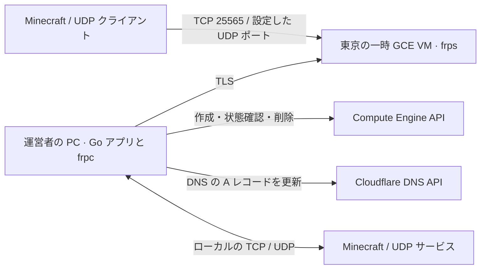

# Minecraft Proxy v2 の設計

## 要件

| 利用者 | できること |
| --- | --- |
| サーバー運営者 | Windows・macOS・Linux のアプリから中継を起動・停止し、接続先・中継状態・稼働期限を確認する |
| Minecraft Java プレイヤー | 運営者の独自ドメインを入力して一覧ピングとログインができる |
| UDP を使うサービスの利用者 | 同じドメインと指定された UDP ポートで接続する |
| サーバー運営者 | PC が落ちても、指定した期限で VM とブートディスクが自動削除される |

最初の版は1設定で1台の中継を管理する。Minecraft サーバーとワールドは運営者の PC で開く。

## 構成

GUI は Wails v3 と React / TypeScript で作り、OAuth・GCE・DNS・`frpc` のプロセス管理は Go 側に置く。ランタイムの GUI サポートは各 OS で確認する。Linux の初期基準は GTK4 / WebKitGTK 6.0 を提供する環境とする。

`frpc` は OS・CPU に対応する公式バイナリを同梱する。VM は同じ版の `frps` を起動時に取得し、固定したチェックサムを検証する。配布物には frp のライセンスを添える。制御接続にはセッションごとの frp トークンと、サーバー証明書を検証する TLS を使う。

## 初回設定と画面

運営者は GCE のプロジェクト、東京のゾーン、VPC、Cloudflare ゾーン、接続先のドメイン、ローカルポート、稼働時間を設定する。通信を許可する GCE の対象タグとファイアウォールルールはセットアップ時に用意する。UDP を使う場合は公開ポートも許可する。

Google と Cloudflare の同意は、アプリから開く既定のブラウザーで行う。デスクトップ OAuth クライアントと Authorization Code + PKCE を用い、トークンは OS の資格情報ストアに保存する。Google は Compute Engine の操作スコープ、Cloudflare はゾーンを探す読み取り権限と DNS 更新権限を要求する。対象 GCP プロジェクトの IAM、Compute Engine API、課金の有効化は各利用者が管理する。外部配布時の OAuth クライアントは各サービスの公開条件を適用する。

画面は起動・停止、接続状態、接続先、稼働期限を配置で伝える。サブタイトルや画面の読み方を説明する文章は置かない。アイコンが必要なら Tabler Icons を使う。操作ラベル、入力ラベル、エラーからの復帰に必要な文、アイコン操作のアクセシブルネームは残す。

## 起動と停止

1. 起動前にローカルの Minecraft サーバーを確認する。対象ドメインから決定的な VM 名を生成し、設定したプロジェクト・ゾーンでその名前を照会する。
2. 同名 VM が見つかったら、管理アプリ・接続先・ローカルに保存した起動セッションの識別子を照合する。一致する場合は状態を復元し、不一致なら操作を止める。新規作成には一時公開 IPv4、VM の自動削除期限、ブートディスクの連動削除を設定する。作成の再試行では同じ `requestId` を使い、名前の競合は既存 VM の再照会で解決する。
3. 新しい VM で `frps` が立ち上がり、`frpc` 経由で Minecraft のステータスが返ったら、公開 IPv4 を DNS-only の A レコードに設定する。既存の CNAME・A・AAAA や Minecraft 用 SRV を切り替える場合は、対象を表示して運営者の選択を受ける。安定運用時の TTL は60秒を目安にする。
4. 停止時は、このアプリが当該セッションで作った DNS レコードを取り除き、VM を削除する。DNS の更新が失敗しても VM の削除を試みる。アプリが強制終了した場合、GCE は期限で VM を削除する。残った DNS は次の起動・停止操作で照合する。

## 受け入れ確認

- Windows・macOS・Linux それぞれでアプリが起動し、該当する `frpc` を使える。
- GUI の未起動、起動中、接続中、エラーの表示を、実クラウドに接続しないスナップショットで確認できる。
- 起動の重複、応答消失後の再試行、運営者が管理していない同名 VM を確認する。
- 外部から独自ドメインで Minecraft Java の一覧ピングとログイン、設定した UDP ポートの往復を確認する。
- 正常停止と強制終了後の期限到達で VM・ブートディスクが削除され、DNS の状態を復元できる。

## 公式仕様

- [GCE の VM 作成 API](https://docs.cloud.google.com/compute/docs/reference/rest/v1/instances/insert) · [VM 名の一意性](https://docs.cloud.google.com/compute/docs/naming-resources) · [VM の稼働時間制限](https://docs.cloud.google.com/compute/docs/instances/limit-vm-runtime)
- [Cloudflare の OAuth](https://developers.cloudflare.com/fundamentals/oauth/create-an-oauth-client/) · [Cloudflare の DNS 更新 API](https://developers.cloudflare.com/api/resources/dns/subresources/records/methods/edit/)
- [デスクトップ向け Google OAuth](https://developers.google.com/identity/protocols/oauth2/native-app) · [frp の TCP / UDP](https://gofrp.org/en/docs/features/tcp-udp/) · [Wails の対応環境](https://wails.io/faq/)
